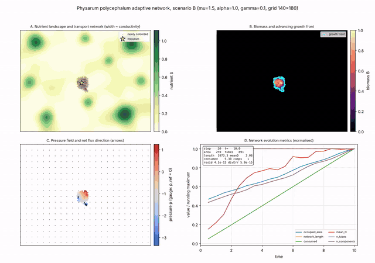
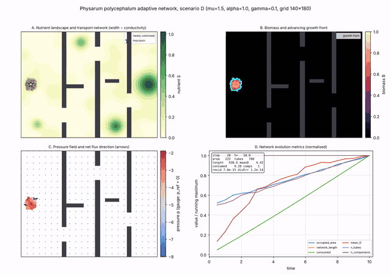
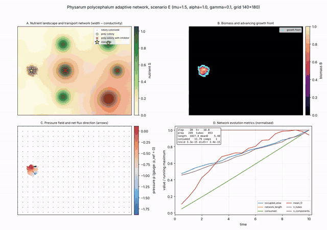
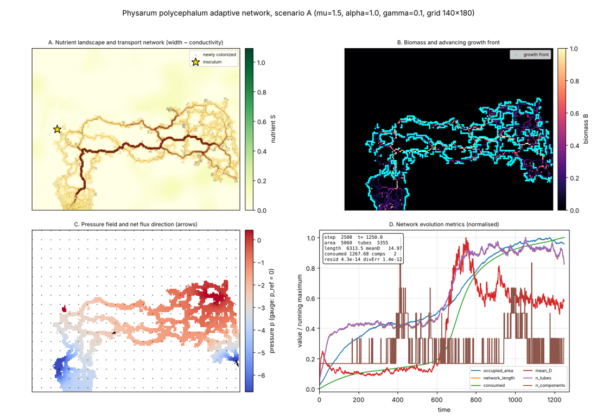
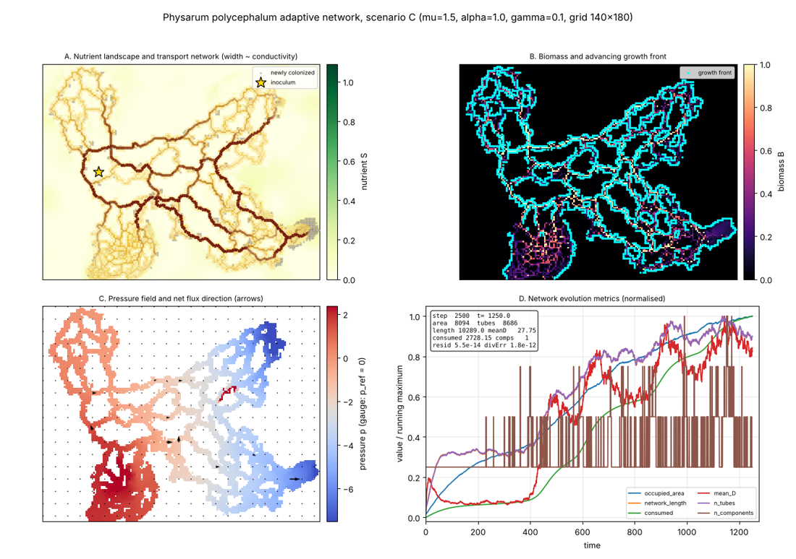
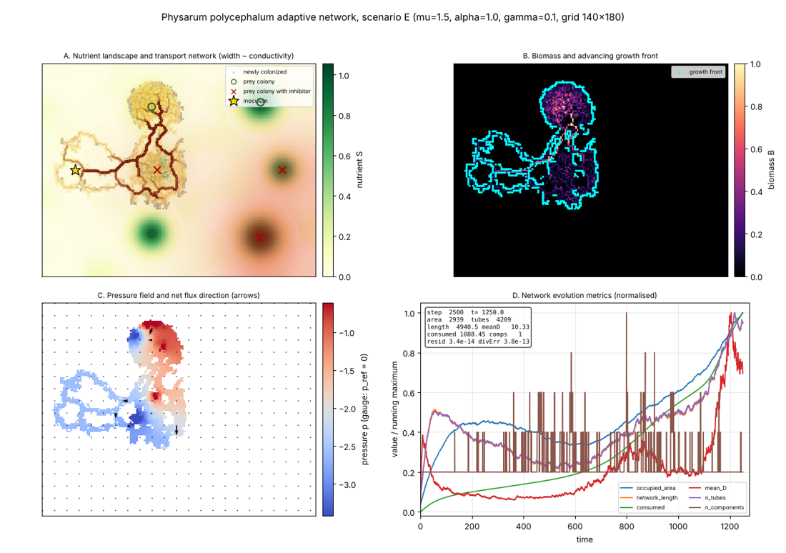
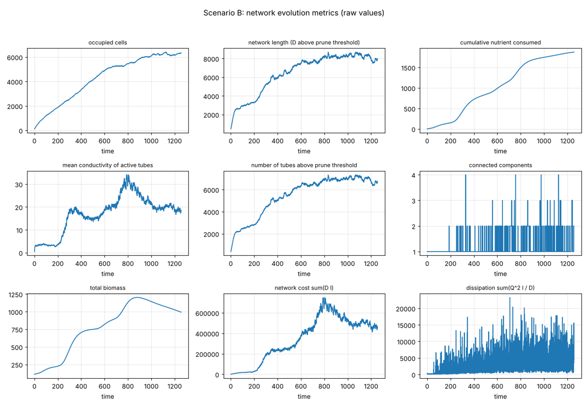

# Physarum polycephalum adaptive transport-network simulation

A scientific Python simulation of the spatial growth, network morphogenesis and nutrient-driven transport of the slime mould *Physarum polycephalum* on a heterogeneous two-dimensional nutrient landscape.

The transport core is the adaptive network model of Tero, Kobayashi and Nakagaki (2007) and Tero et al. (2010): pressure-driven Poiseuille flow on a graph, with tube conductivities that grow with the flux they carry and decay otherwise. A separate, clearly labelled colonization layer lets the organism expand from an inoculum toward food as an advancing fan, consolidate the sheet behind the fan into a vein network, prune veins that stop carrying flow, and reorganize when the food changes. The default grid is 140 by 180 cells with 8-connectivity (about 100,000 potential tubes).



## What the simulation does

- Expands from an inoculation point across a nutrient landscape made of Gaussian patches, correlated noise, nutrient-poor gaps and, in the labyrinth scenario, impassable walls.
- Senses distant food through a diffusing attractant field and colonizes neighbouring cells preferentially along its gradient; no cell is ever occupied without an occupied neighbour.
- Consolidates the sheet behind the advancing fan into veins: old film cells drain into the reinforced tubes and are abandoned, so the organism keeps the morphology of a living plasmodium (fan, veins, loops) rather than a filled blob.
- In the prey scenario, grazes bacterial colonies that regrow, and senses a diffusing inhibitor released by some colonies, which repels the front and kills biomass; whether a colony is grazed or avoided is an emergent trade-off.
- Solves the pressure field and the signed fluxes of the transport network at every step with a sparse direct solver, with one gauge per connected component and exact current balance.
- Reinforces tubes that carry flow and prunes tubes that do not, following dD/dt = alpha |Q/Q0|^mu - gamma D.
- Depletes nutrient only where the organism feeds, grows biomass from uptake, moves biomass along the flow, and retracts from starved regions.
- Reports numerical validation every run: linear-solve residual, local mass balance, component current balance, nutrient accounting, colonization adjacency, nonnegativity of nutrient and conductivity.

## Scenarios

Scenario A has one inoculum and one distant nutrient patch. The organism extends a fan toward the patch, reaches it after about 1,500 steps, and a main vein with secondary branches links the inoculum to the feeding site.

Scenario B has nine patches of different sizes and strengths at irregular positions. The organism visits them in sequence and leaves a looped vein network connecting the consumed patches.

Scenario C starts with two patches and adds a third one at step 500 and a fourth at step 1500. The organism finds each new patch and the vein network reroutes toward the next front.

Scenario D is a labyrinth: three walls with offset gaps and two baffles separate the inoculum from a large patch, with small patches in side chambers. Walls block transport, attractant diffusion and colonization. The organism threads the gaps along the attractant gradient.



Scenario E replaces the patches with six bacterial colonies that regrow when grazed. Three of them (red crosses) release a diffusing inhibitor (red haze) that suppresses colonization and kills biomass. The organism feeds on the benign colonies (green circles), grazes the weak central inhibitor colony at a large biomass cost, and avoids the strong ones.



## Final states

Panel A shows the nutrient field, the translucent body and the tubes (width and opacity scale with conductivity). Panel B shows biomass and the growth front. Panel C shows the pressure field and the net flux direction. Panel D shows the network metrics, each normalised by its running maximum.







Raw time series of the metrics for scenario B (occupied cells, network length, nutrient consumed, mean conductivity, number of tubes, components, biomass, network cost and dissipation):



## Installation

Python 3.9 or later is required.

```
pip install -r requirements.txt
```

The package list is numpy, scipy and matplotlib for the simulation, openpyxl for the Excel export of plot_metrics.py, and pytest for the tests. ffmpeg is needed only for MP4 export; GIF export works without it.

## Running

Interactive animation of scenario B with the default 140 by 180 grid and 2,500 steps:

```
python physarum_sim.py
```

Choose the scenario (A to E), the grid size and the duration. Lengths and rates are rescaled with the grid, so a 70 by 90 run reproduces the same dynamics at lower resolution in a fraction of the time:

```
python physarum_sim.py --scenario D --steps 4000
python physarum_sim.py --scenario E --steps-per-frame 10
python physarum_sim.py --scenario B --H 70 --W 90 --steps 1500
```

Run headless, save a snapshot of the four panels every 625 steps and write the metrics CSV:

```
python physarum_sim.py --scenario B --no-anim --snapshot-every 625 --outdir physarum_output
```

Export the animation (the GIFs in this repository were rendered as MP4 with ten steps per frame and converted with ffmpeg):

```
python physarum_sim.py --scenario B --save physarum_B.gif --steps-per-frame 10
python physarum_sim.py --scenario B --save physarum_B.mp4 --steps-per-frame 10 --fps 15
```

Validation suite and comparison of the flux exponent mu:

```
python physarum_sim.py --test
python physarum_sim.py --compare-mu --H 50 --W 64 --steps 1000
pytest tests
```

Plots of the raw metric time series and an Excel workbook from the CSV files:

```
python plot_metrics.py --outdir physarum_output
```

The main options are `--mu`, `--alpha`, `--gamma`, `--Q0` for the adaptation rule, `--connectivity 8` for diagonal tubes, `--solver cg` for a conjugate-gradient solver on large grids, `--n-sources` and `--n-sinks` for the number of source and sink sites drawn per step (0 selects the diffuse allocation), `--regen` for nutrient regeneration, `--seed` and `--dt`.

A headless run of 2,500 steps on the default grid takes 60 to 90 seconds on a laptop; the 70 by 90 grid runs 1,500 steps in about 8 seconds.

## Model summary

The equations, the source and sink allocation, the colonization rule, the parameter interpretation, the scientific limitations and the references are documented in [docs/model_documentation.md](docs/model_documentation.md) (also available as a Word file in the same folder). The short version:

- Tero model (verified against the original papers): L p = I on the conductivity-weighted graph Laplacian; Q_ij = (D_ij / l_ij)(p_i - p_j); dD_ij/dt = alpha |Q_ij / Q0|^mu - gamma D_ij, integrated with an exponential integrator and clipped to [D_floor, D_max].
- Extensions written for this repository: a biomass field with saturating nutrient uptake, yield and maintenance; a quasi-steady chemoattractant released by concentrated food; a stochastic colonization rule into adjacent cells biased by local nutrient and by the relative attractant gradient; a source and sink allocation that draws a few source and sink sites per step per component (the analogue of the random-pair driving of Tero et al. 2010) with exact current balance; biomass transport along the solved flow with a per-source cap and exact conservation per component; cytoplasm spreading inside the young fan; consolidation of old film cells into veins and abandonment of tube-less film behind the fan; soft pruning of tubes below a conductivity threshold; obstacles; regrowing bacterial prey with a diffusing inhibitor.

The flux exponent mu controls competition between tubes. With mu = 1 the network converges to shortest paths but, on a sheet with changing source and sink sites, keeps every lattice edge alive; with mu above 1 the rule is winner-take-all and the lattice is pruned into veins. The default mu = 1.5 gives a main trunk with secondary branches; mu = 2 leaves a single trunk.

## Validation

`python physarum_sim.py --test` runs unit tests of the transport core (reinforcement and decay, disconnected components, two-path competition for mu = 1 and mu = 2) and a 150-step full-model run, and checks that the linear-solve residual is below 1e-8, the local mass-balance error below 1e-8, the component current balance below 1e-10, the nutrient accounting exact, no cell colonized without an occupied neighbour, nutrient nonnegative and conductivity finite and positive. The same checks run as pytest tests in `tests/`.

These checks validate the numerics of the model. They do not validate the model against measurements on the organism; the colonization layer rests on stated assumptions with illustrative parameter values.

## Repository layout

- `physarum_sim.py`: the complete simulation (model, solver, colonization, visualization, tests, command-line interface).
- `plot_metrics.py`: plots of the raw metric time series and an Excel export.
- `docs/`: model documentation (Markdown) and the per-step metrics of the five default runs (one Excel workbook, one sheet per scenario).
- `assets/`: the three GIF animations and four figures shown in this README.
- `tests/`: pytest suite.

## References

- Tero A., Kobayashi R., Nakagaki T. (2007). A mathematical model for adaptive transport network in path finding by true slime mold. Journal of Theoretical Biology 244, 553 to 564.
- Tero A., Takagi S., Saigusa T., Ito K., Bebber D. P., Fricker M. D., Yumiki K., Kobayashi R., Nakagaki T. (2010). Rules for biologically inspired adaptive network design. Science 327, 439 to 442.
- Nakagaki T., Yamada H., Tóth Á. (2000). Maze-solving by an amoeboid organism. Nature 407, 470.
- Bonifaci V., Mehlhorn K., Varma G. (2012). Physarum can compute shortest paths. Journal of Theoretical Biology 309, 121 to 133.
- Jones J. (2010). Characteristics of pattern formation and evolution in approximations of Physarum transport networks. Artificial Life 16, 127 to 153.
- Alim K., Amselem G., Peaudecerf F., Brenner M. P., Pringle A. (2013). Random network peristalsis in Physarum polycephalum organizes fluid flows across an individual. Proceedings of the National Academy of Sciences 110, 13306 to 13311.

## License

MIT License. See `LICENSE`.
